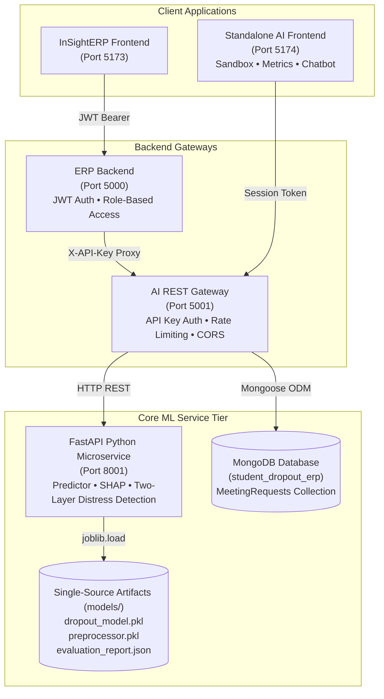

# AI-Powered Student Dropout Prediction and Intervention System

A standalone, end-to-end predictive and intervention platform designed for Indian engineering institutions. Combines a **defensible XGBoost machine learning model** with **SHAP explainability**, an **Express/MongoDB REST gateway**, a **Python FastAPI ML microservice**, and an **interactive React retention dashboard with an empathetic advisor**.

---

## 1. System Architecture



---

## 2. Setup & Local Installation

### Prerequisites
- Node.js >= 18.x
- Python >= 3.10 with `pip`
- MongoDB (local or Atlas)

### Step 1: Environment Setup
```bash
cd backend
cp .env.example .env
```
Configure `backend/.env`:
- `PORT=5001`
- `API_KEY=replace_with_shared_service_api_key_in_production` (Must match ERP)
- `ALLOWED_ORIGINS=http://localhost:5173,http://localhost:5174,http://localhost:3000`
- `MONGO_URI=mongodb://localhost:27017/student_dropout_erp`
- `ML_SERVICE_URL=http://localhost:8001`
- `MODEL_DIR=../models`

### Step 2: Install Dependencies
```bash
# Gateway dependencies
cd backend
npm install

# ML Service dependencies
cd ../ml-service
pip install -r requirements.txt
pip install pytest httpx
```

### Step 3: Run the Services
```bash
# Terminal 1: Python FastAPI ML Microservice (Port 8001)
cd ml-service
python -m uvicorn app.main:app --port 8001

# Terminal 2: Node.js Express Gateway (Port 5001)
cd backend
npm start

# Terminal 3: React Vite Standalone Frontend (Port 5174)
cd frontend
npm install
npm run dev
```

---

## 3. Machine Learning Training Pipeline

Train and evaluate the defensible early-warning model:
```bash
cd models
python train_pipeline.py
```
This executes:
1. **Stratified 60/20/20 train/validation/test split** (seed 42).
2. **Stratified 5-fold cross-validation** on the training set evaluating candidate models and imbalance strategies (SMOTE vs balanced class weighting) using `imblearn.pipeline.Pipeline`.
3. **Hyperparameter tuning** via `RandomizedSearchCV` (30 iterations) optimizing Macro-F1.
4. **Single-pass final evaluation on the untouched holdout test set** (N = 1,840).
5. **Ablation experiments** (impact of omitting attendance or semester marks).
6. **Subgroup fairness analysis** across 13 departments and first-generation learner status.
7. **SHAP explainability generation** and serialization to `models/dropout_model.pkl` and `models/evaluation_report.json`.

---

## 4. Running Verification Tests
Execute the unified test runner:
```powershell
# Windows PowerShell:
.\run_tests.ps1

# Linux / macOS:
chmod +x run_tests.sh
./run_tests.sh
```

Or run individual suites:
```bash
# Backend Jest Security & Chat Safety Suite:
cd backend
npm test

# ML Service Pytest Suite:
cd ml-service
python -m pytest tests
```

---

## 5. Security & Safety Invariants
- **API Key Fail-Closed**: Missing or invalid `X-API-Key` returns 401. If `API_KEY` is unset, the gateway refuses to start.
- **Chatbot Honesty Invariant**: The bot never falsely claims to have notified a counselor unless a `MeetingRequest` record was successfully committed to MongoDB.
- **Crisis Guardrails**: Two-layer distress detection returns deterministic emergency helplines (Tele-MANAS: 14416, KIRAN: 1800-599-0019).
- **Mandatory Disclaimer**: All responses carry: *"AI academic assistant. Not a substitute for professional counseling or official academic advice."*
- Full details documented in [docs/security.md](docs/security.md).
